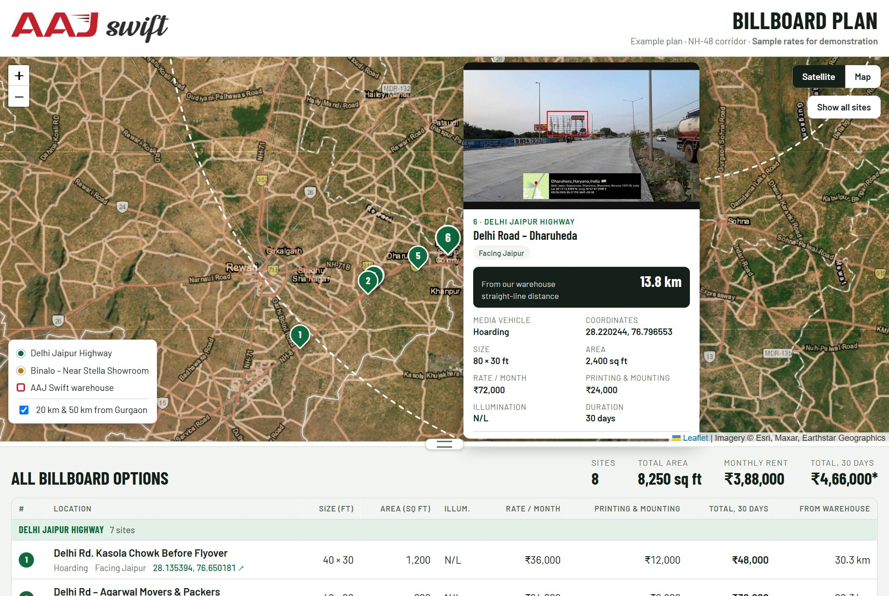
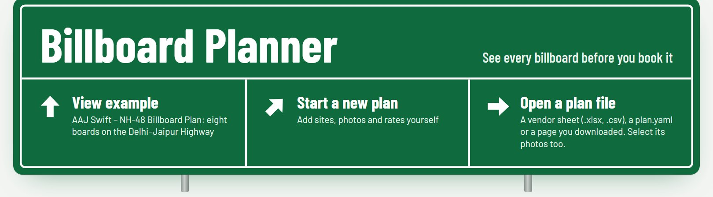

# Billboard Planner

**See every billboard before you book it.**



Media vendors send billboard options as a spreadsheet: a location name, a size, a rate, and if you are lucky, a photo and a pair of coordinates. Deciding from that means jumping between Excel, Google Maps and WhatsApp photos, and still not knowing which board faces which way or how far it is from where your customers are.

Billboard Planner puts it all on one page. Drop in the vendor sheet and the site photos, and you get a satellite map with every board pinned, a card for each site with its photo, size, rate and distance from your base, and a clean costing table with totals underneath. The result is a single HTML file you can email, share on WhatsApp or host anywhere.

### Try the example
Open the app and choose **View example** to explore a real plan: seven hoardings and a unipole along the NH-48 Delhi–Jaipur Highway near Dharuhera, planned by **AAJ Swift** from its Gurugram warehouse. (Rates in the example are sample figures.)

**[Open the example](https://shashankshekharans.github.io/billboard-planner/#example)** · [Open the app](https://shashankshekharans.github.io/billboard-planner/)

### What you get
- 🛰️ **Satellite and road map** with numbered, colour-coded pins for every site
- 🖼️ **Hover cards** with site photos, size, rate, printing cost and facing direction
- 📍 **Distance from your base**, such as a warehouse, store or office, for every site
- ⭕ **Radius rings** (e.g. 20 km and 50 km) to see coverage at a glance
- 📊 **Costing table** grouped by route, with subtotals and a grand total
- 📦 **One self-contained file**: photos, logo and data built in, nothing to install for viewers
- 🔍 **Full-size photos**: click a card's photo to view it full screen, with arrows for sites that have several
- 🏙️ **City markers** (e.g. Gurgaon, Manesar) to help people find their way around the map
- 🧭 Reads vendor coordinates in any common format, including degrees-minutes-seconds

### Made for
Marketing teams, media planners and agencies who buy outdoor (OOH) media: hoardings, unipoles, gantries and bus shelters.

---

## Quick start: in the browser

[](https://shashankshekharans.github.io/billboard-planner/)

1. Open **[the app](https://shashankshekharans.github.io/billboard-planner/)**. Nothing to install; your plan stays in your browser.
2. Choose **Open a plan file** and select the vendor's spreadsheet together with the site photos, or **Start a new plan** and add sites by hand.
3. Fix anything listed under **Checks** (a missing size, unreadable coordinates, a site far from the rest).
4. Click **Download page**. Send that one `.html` file to your team. You can open it in the app again later to edit it.

## Quick start: from the command line

For teams who keep plans in a folder or want to build many plans. Needs [Node.js](https://nodejs.org) 20 or newer.

```bash
git clone https://github.com/shashankshekharans/billboard-planner.git
cd billboard-planner
npm install
npm run build
npm run plan -- build path/to/sites.xlsx        # writes path/to/sites.html
```

The folder can look like this:

```
my-plan/
  sites.xlsx        or plan.yaml
  photos/           1.jpg, 2.jpg, 6a.jpg, 6b.jpg … named by site ID
  logos/            logo.png (header), mark.png (map marker for your base)
```

`npm run build:example` builds the AAJ Swift example into `examples/aaj-swift-nh48/plan.html`. See [packages/cli](packages/cli/README.md) for all options.

## The spreadsheet

Start from [`templates/sites-template.xlsx`](templates/sites-template.xlsx), or use the vendor's own sheet: columns are matched by name, including the usual OOH wording.

| What | Column names that work |
|---|---|
| Site number | `ID`, `S.No`, `Sr No`, `Code` |
| Group (route or area) | `Group`, `Route`, `Zone`, `Corridor` |
| Location | `Location`, `Site`, `Address` |
| Coordinates | `Coordinates`, `Lat Long`, `GPS`, a Google Maps link, or `Latitude` + `Longitude` |
| Size | `Size` (`40 x 30`), or `Width` + `Height` |
| Rate | `Rate / month`, `D.C.P.M`, `Monthly rate`, `Rent`, `Card rate` |
| Printing | `Printing & mounting`, `P&M`, `Flex`: a number, `Extra` or `TBC` |
| Others | `Media Vehicle`, `Fcg` / `Facing`, `Qty`, `Illum.`, `Days`, `GST` / `Tax`, `Remarks`, `Photos` |

Coordinates can be in any common format: `28.135394, 76.650181`, `Lat 28.186815, Long 76.722692`, `28.30119° 76.872404°`, or `Lat 28°10'58.4895"N, Long 76°43'3.3067"E`. Money such as `₹1,50,000` or `Rs. 24000` is read as a number. Total rows and Area columns are skipped; the planner works them out.

The workbook's optional **Plan** sheet sets the title, logo, currency, your base, the radius rings and city markers (`City` rows such as `Manesar: 28.3540, 76.9395`); the **Groups** sheet sets group colours. Prefer a text file? [`examples/aaj-swift-nh48/plan.yaml`](examples/aaj-swift-nh48/plan.yaml) shows every field, and [packages/core](packages/core/README.md) lists the rules.

### How costs are worked out
- Area = width × height × quantity.
- Total = monthly rate × days ÷ 30 + one-time printing & mounting.
- Printing marked **Extra** or **TBC** counts as 0 and the totals get an asterisk with a footnote. A tax note such as "GST extra" is shown on the card.
- Distances are straight-line from your base.

## Sharing the page

- The page is **one `.html` file** (about 1 MB for 10 photos) with the photos, logos and data inside. Email it, send it on WhatsApp, put it on a shared drive, or host it (GitHub Pages, Netlify).
- It needs the internet only for **map tiles** and the Leaflet map script.
- Open it in a normal browser. It does **not** work inside chat-app or AI-assistant previews (including Claude.ai artifacts), which block map tiles from outside hosts: download it first.
- Anyone with the file can read the rates in it. Share it only with people who should see them.

## Map tiles and licensing

The map uses **Esri World Imagery** (satellite, with Esri's reference labels and roads) and **Esri World Street Map** (road map), loaded live from Esri's servers. Attribution is always shown in the corner of the map; keep it visible.

- These basemaps are provided under **Esri's terms of use**. Light use with attribution is the intended use; for heavy or commercial use, check Esri's terms or use a provider you have an account with.
- The provider is configurable: in `plan.yaml`, set `map.providers.satellite` or `map.providers.road` to `{ url, attribution, max_zoom }` for any XYZ tile service, for example **MapTiler**, **Mapbox** or **Stadia Maps** with your own key, and follow that provider's terms.
- **Do not use `tile.openstreetmap.org`**: OpenStreetMap's tile server refuses pages opened from a file (they send no Referer), and its usage policy does not allow apps like this to rely on it.
- Tiles are never downloaded in bulk or cached by Billboard Planner.

## Keeping real rates private

**Never commit real vendor rates to a public repository.** Name private plans `something-private.xlsx` (or `.yaml`) or keep them in a `private/` folder: both are ignored by git, so you can keep real plans next to this repository safely. The bundled AAJ Swift example uses sample rates only.

## For developers

```
packages/
  core/        plan schema (zod), coordinate parser, cost maths, distance, spreadsheet column mapping
  cli/         `billboard-planner build`: reads YAML/JSON/CSV/XLSX, optimises and embeds images
  template/    the generated page: plain HTML, CSS and JS with Leaflet 1.9.4 from cdnjs
  app/         browser app (Vite + Preact): start screen, example, editor; published to GitHub Pages
examples/
  aaj-swift-nh48/   default example: plan.yaml, photos, logos, reference/billboard-plan-example.html
  index.json        bundled examples
templates/     sites-template.xlsx
e2e/           Playwright smoke tests for the app and a generated page
```

```bash
npm install
npm run build          # core + cli
npm test               # unit tests (Vitest, node:test)
npm run typecheck
npm run dev            # the app on http://localhost:5173
npm run build:app && npm run build:example
npx playwright install chromium
npm run test:e2e       # Playwright smoke tests
```

The AAJ Swift example is checked against the hand-built reference page: the tests read the data inside `reference/billboard-plan-example.html` and compare every site, distance, total (₹4,66,000*) and photo with a fresh build from `plan.yaml`.

CI runs on every push and pull request, and every push to `main` republishes the app to GitHub Pages ([workflows](.github/workflows), [readable copies](docs/github-workflows/README.md)).

## Licence

[MIT](LICENSE). The AAJ Swift name, logos and site photos in `examples/aaj-swift-nh48` belong to AAJ Swift and are included only as an example.
